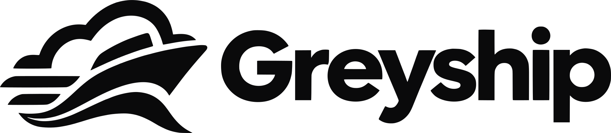
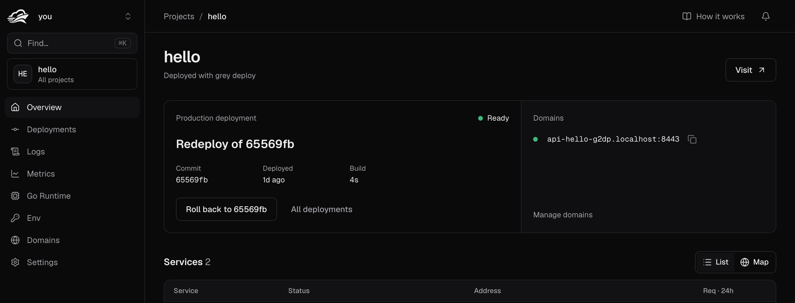
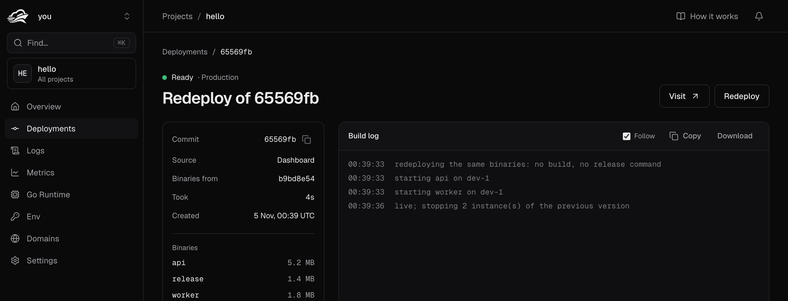
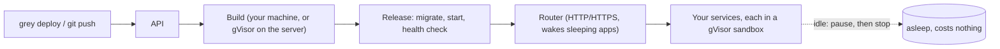

<div align="center">

<picture>
  <source media="(prefers-color-scheme: dark)" srcset="web/public/brand/greyship-lockup.svg">
  
</picture>

**An open-source platform to deploy Go backends on your own server.**<br>
Scale to zero. No Dockerfile. No YAML. Just `grey deploy`.

[](https://github.com/greylabss/greyship/releases)
[](LICENSE)
[](go.mod)

[Website](https://greyship.tech) · [Documentation](https://docs.greyship.tech) · [Self-hosting guide](https://docs.greyship.tech/self-hosting) · [Join the beta](https://forms.greyship.tech) · [Discussions](https://github.com/greylabss/greyship/discussions)



</div>

> **Status: early.** Greyship runs real apps and is in a private beta, but expect rough edges and breaking changes.
> It's a single-server setup for now.

## What is Greyship?

Greyship is a self-hostable serverless platform made for **Go**. You point it at a normal Go project, and it reads your
code to find your services, builds them, runs each one in its own [gVisor](https://gvisor.dev) sandbox, gives web
services a URL, and **puts them to sleep when nobody is using them**. The next request wakes them in milliseconds.

You need a server and an SSH session, nothing else. Everything runs on your machine, your data stays there, and your
apps keep running if you ever stop using Greyship.

```text
$ grey deploy

  api      web     ./cmd/api      starts a server in cmd/api/main.go:30 (http.ListenAndServe)
  worker   worker  ./cmd/worker   no server start found from main()
  release  once    ./cmd/migrate  cmd/migrate is the release command

Building here with go1.27 for linux/amd64
Uploaded 3 binaries (7.8 MB)

  │ release command finished
  │ starting api on greyship-1
  │ live

✓ Live
  api     http://api-hello.apps-203-0-113-7.sslip.io
  worker  (worker, no URL)
```

## What can Greyship do?

- **Deploy any Go backend.** APIs, workers and crons from one repo. Greyship finds every `main` package and decides
  whether it serves HTTP, so a normal project needs no config at all.
- **Build where you like.** On your laptop (only changed binaries are uploaded), or on the server inside gVisor, so
  you don't even need Go installed to deploy.
- **Deploy from GitHub.** Paste a public repository's link, or create the GitHub App with one click in the dashboard for push-to-deploy. Review the
  services Greyship found and set env vars before the first deploy.
- **Never break production.** A new version must pass its health check before it gets traffic. If anything fails,
  nothing changes and the live version keeps serving. Roll back to any earlier deployment in seconds, with no rebuild.
- **Scale to zero.** Idle web services pause after 30 seconds and cost nothing. They wake on the next request, and
  scale up under load.
- **Listen anywhere.** Use `:3000`, `localhost:4000` or `$PORT`; Greyship serves it. Ship templates and scripts next to
  your binary with `files = [...]` in `greyship.toml`.
- **Manage config and secrets.** Env vars encrypted at rest, a release command for migrations, and a `.env.prod` diff
  before every deploy.
- **See what's happening.** Live build and runtime logs, a bell, browser push and optional email for deploys, and an admin view
  to debug any deployment by its id.
- **Run it safely.** Every app lives in a gVisor sandbox with its own network, so tenants can't reach each other, the
  host, or Greyship's internals. Nobody can sign themselves up: the first visitor creates the owner, and the owner adds everyone else with an email and password, and can limit how much each user may use.
- **Use it your way.** One API under both the dashboard and the `grey` CLI; every action is available in both.

<div align="center">

</div>

## Quick start

Install Greyship on a fresh Ubuntu or Debian server, as root:

```bash
curl -fsSL https://greyship.tech/install | sudo sh
```

That's all: **no domain needed**. It installs Docker, gVisor, Postgres and everything else, then tells you to open
`http://<your-server-ip>:8000` and create your account. The first account is the owner. When you have a domain, run
`greyship-admin domain` on the server to move to HTTPS.

Then, on your laptop, install `grey` already pointed at your server (the installer prints this exact command):

```bash
curl -fsSL http://<your-server-ip>:8000/install | GREY_SERVER=http://<your-server-ip>:8000 sh
grey login
cd my-go-project && grey deploy
```

Read the [self-hosting guide](https://docs.greyship.tech/self-hosting) for requirements and options, or review the
[installer](deploy/install/install.sh) before you run it.

## How it works



Five small Go services (API, builder, scheduler, node agent, router) and a dashboard, on one server with Postgres and
S3-compatible storage. The long version is in [`docs/how-it-works.md`](docs/how-it-works.md) and
[`docs/architecture.md`](docs/architecture.md).

## Self-hosted, and our beta

Greyship is software you run on your own server: free, open source, no plans, no billing. Our private beta is just
another instance we run; we add each tester as a user ([apply here](https://forms.greyship.tech)).

## What works today, and what's next

**Works today:** everything above, on one server: deploys from the CLI and GitHub, rollbacks, env vars, logs,
notifications, the admin view, and the installer.

**Coming next:** workers that wake on events and crons that run on schedule, custom domains from the dashboard, a guided
SMTP email, metrics, multiple servers, and Firecracker microVMs for faster cold starts. See
[`docs/spec.md`](docs/spec.md).

## Build from source

Go 1.27, Docker (for Postgres and storage), and [Lima](https://lima-vm.io) on macOS for the gVisor sandboxes:

```bash
make up        # infrastructure, the sandbox VM, and every service
make login
make hello     # deploys examples/hello
make test      # unit tests; make test-int for integration tests
```

See [`docs/try-it.md`](docs/try-it.md) and [`CONTRIBUTING.md`](CONTRIBUTING.md).

## Community and support

- Read the [documentation](https://docs.greyship.tech).
- Ask questions and share ideas in [GitHub Discussions](https://github.com/greylabss/greyship/discussions).
- Found a bug? [Open an issue](https://github.com/greylabss/greyship/issues).
- Read the [contribution guide](CONTRIBUTING.md) and the [code of conduct](CODE_OF_CONDUCT.md).
- Report security problems privately through the repository's [Security tab](SECURITY.md).

## Star history

[](https://star-history.com/#greylabss/greyship&Date)

## Licence

[AGPL-3.0](LICENSE). You can run, study and change Greyship freely. If you offer a modified Greyship to others over a
network, you must publish your changes under the same licence.
