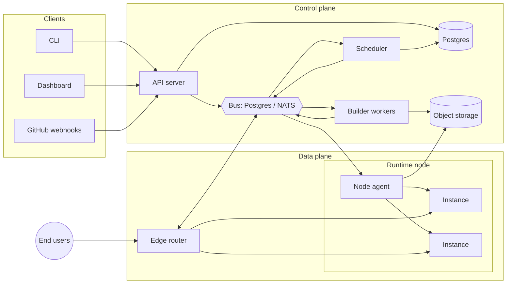
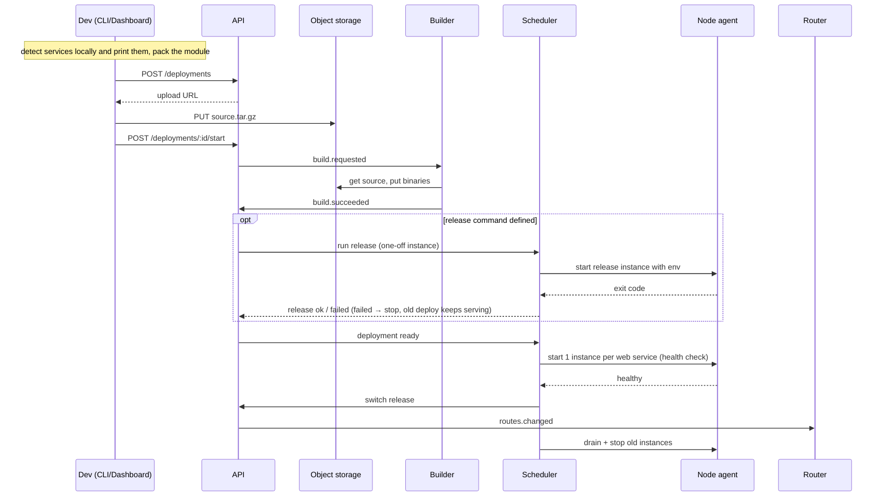

# Greyship — Technical Architecture

> Companion to `spec.md`. For the plain-language version, see `architecture-explained.md`.
> Last updated: 2026-10-26

---

## 1. Overview

Greyship has two planes:

- **Control plane** — decides *what* should run: accounts, projects, deployments, config, scheduling, billing.
- **Data plane** — actually *runs* it: routers that receive traffic, nodes that host sandboxed app instances.

Two paths cross them:

- **Deploy path:** source → builder → artifact → scheduled onto nodes.
- **Request path:** client → edge router → instance (waking it if needed).



Every component is written in Go except the dashboard.

---

## 2. Components

### 2.1 API server (`greyship-api`)
- Stateless HTTP/JSON server, `/v1` REST. Serves CLI, dashboard and GitHub webhooks.
- Auth (decisions.md 053): email and password only (PBKDF2-HMAC-SHA256, 600,000 iterations, a salt each; no emailed codes, no OAuth sign-in, no signup). `GET /v1/auth/setup` says whether the instance still needs its owner; `POST /v1/auth/setup` creates the owner and signs them in, once (only while `users` is empty, under a table lock; only for `GREYSHIP_OWNER_EMAIL` when set). `POST /v1/auth/password/login` limits failures to 8 per email and 30 per IP in 15 minutes and answers the same for a wrong password and an unknown email. Dashboard sessions are opaque cookies stored hashed; the CLI uses the device flow and bearer tokens. A forgotten password is reset on the server: `greyship-api reset-password <email>` (via `greyship-admin reset-password`) sets a random password and ends the account's sessions.
  - `grey login` (RFC 8628): the CLI gets a `device_code` + human `user_code` (`XXXX-XXXX`, consonants only, 10 minutes), opens `{dashboard}/device?code=…`, and polls `/v1/auth/device/token` every 5s (`authorization_pending`, `slow_down`, `access_denied`, `expired_token`). On approval it receives a team-scoped `gs_` API token exactly once.
  - Every account has a personal team (made with the account) whose slug comes from the email's local part. Team slugs are the first segment of dashboard URLs (`/<team>`), so words used by site pages and auth routes (`blog`, `features`, `pricing`, `but`, `signin`, `signup`, `device`, …) are reserved and get a `team-` prefix.
  - Every authenticated endpoint accepts `Authorization: Bearer gs_…` or the session cookie. The API answers CORS only for `GREYSHIP_DASHBOARD_URL`, with credentials.
  - Browser-session hardening (decision 038):
    - The session cookie is `__Host-gs_session` (Secure, `Path=/`, no `Domain`), so no other host can set or overwrite it; plain `gs_session` in development over http.
    - CSRF: a POST, PATCH or DELETE that could ride on the session cookie must carry `Origin: <GREYSHIP_DASHBOARD_URL>`, or it gets 403 `bad_origin`. Bearer-token requests (CLI, CI) need no Origin, since a forged request can't carry the token, and neither do logged-out script calls with no session cookie (the device flow, `login.sh` signing in).
    - Client address for per-IP limits: the API only sees loopback connections from the router, so it takes the address the router saw from `X-Forwarded-For` (the router drops any the client sent). When that is the dashboard's `/v1` proxy, the browser's address comes in `X-Greyship-Client-IP`, trusted only alongside `X-Greyship-Proxy-Secret` = `GREYSHIP_PROXY_SECRET`.
    - Dashboard on the same origin: `web/proxy.ts` forwards `/v1/*` on the dashboard's host to `GREYSHIP_API_URL`, adding the visitor's address and the proxy secret. Browser calls (sign-in, device approval) go to relative `/v1`, so the session cookie is host-only on the dashboard and CORS isn't needed; server components call the API directly, forwarding that cookie. `NEXT_PUBLIC_DASHBOARD=open` opens the dashboard and sign-in routes while the marketing site is still `coming-soon`. After sign-in, `/continue` sends people to their first team; dashboard pages send signed-out visitors to `/signin?next=…`.
  - Authorization: the caller must be a member of the resource's team (non-members get 404, so teams can't be probed); `viewer` is read-only. A bearer token acts only within the team it was issued for (403 `wrong_team` otherwise); a session cookie covers every team the user belongs to. `/v1/me` returns `token_team` when called with a token.
- GitHub deploys (`internal/github`, decisions.md 042, 055). Greyship is a **GitHub App**, created by the instance admin from the dashboard (below): it reads only the repositories each installation chose, with short-lived installation tokens minted from the app's private key (RS256 JWT), and never stores a GitHub token.
  - **Creating the app (decisions.md 055):** each team has its own. `POST /v1/teams/{team}/github/app/manifest` (a member who can write) returns the app manifest and the GitHub page to post it to, with a signed `state` (team, user, 10 minutes); GitHub sends the browser back to `GET /v1/github/manifest/callback?code&state`, where the API checks the state against the signed-in user and their write access, exchanges the code with `POST /app-manifests/{code}/conversions` and stores the credentials in `github_apps` (one row per team; client secret, private key and webhook secret sealed with the master key). `GET /v1/teams/{team}/github/app` shows whether the team has one; `DELETE` removes it with its installations. `github.Apps` reads a team's row on use (cached 30 seconds, cleared after a save), in the API and the builder; `github.Dynamic` finds the app for a call through the installation's team, and public repositories use no app. With no app, the team's install and repos routes answer 404 `github_off`.
  - **Install:** `GET /v1/teams/{team}/github/install` returns `github.com/apps/<slug>/installations/new?state=<signed team+user>`. GitHub comes back to `GET /v1/github/callback` on the dashboard's origin, so the session is present. The API checks the state was signed for this signed-in person and team, exchanges the `code` for a user token, and records the installation **only if `GET /user/installations` with that token lists it**, so knowing an installation id isn't enough to claim one.
  - **Repos, import, connect:**
    - `GET /v1/teams/{team}/github/repos` lists what the team's installations can read.
    - `POST /v1/teams/{team}/github/import {repo, branch?}` creates the project (named after the repo, `-2`… when taken), connects it, and deploys the branch head.
    - `POST|GET /v1/projects/{id}/github` connects or shows the repo.

    A repo must belong to one of the team's own installations.
  - **Push:** `POST /v1/github/webhook` accepts only deliveries whose `X-Hub-Signature-256` matches that team's stored webhook secret (`POST /v1/github/webhook/{team}`), and only installations of that team count. A `push` to a connected `refs/heads/<branch>`, from the installation that connected it, creates a `source='github'` deployment (one per project and commit, so repeated deliveries do nothing) and a `github.fetch` job.
  - **Fetch (builder):**
    1. Downloads `/repos/{repo}/tarball/{sha}` (at most 400MB).
    2. Unpacks it without GitHub's top folder, refusing path escapes and skipping symlinks.
    3. Repacks it with `internal/pack`, so `.gitignore`, `.greyshipignore` and the never-upload rules (`.git`, `.env*`, symlinks) apply exactly as for `grey deploy`.
    4. Stores it at `sources/<project>/<deployment>.tar.gz` and queues the build.

    Missing commits and oversize repos fail the deployment; GitHub or storage outages retry.
  - **Commit status:** the builder sweeps every 5s for GitHub deployments whose status on GitHub is behind (`github_reported`), and posts `pending`, `success` or `failure` with `context: Greyship` and a link to the deployment page.
  - **Public repositories by link** (decision 043):
    - `POST /v1/teams/{team}/github/import-url {url, branch?}` parses the link (github.com only).
    - It reads the branches and the default branch from git's smart-HTTP ref list (`github.com/<repo>.git/info/refs?service=git-upload-pack`, pkt-line), not the REST API, whose unauthenticated limit of 60 calls an hour per IP the whole server would share.
    - It connects the project with `installation_id` NULL and deploys the head.
    - The fetcher downloads `codeload.github.com/<repo>/tar.gz/<sha>`, with no token, and repacks it like any other.

    Pushes and commit statuses skip these projects.
  - **Import without deploying, and preview:** both imports take `"deploy": false` (the dashboard sends it; without it they deploy, as the CLI expects). `GET /v1/projects/{id}/github/preview` downloads the branch head, reads key *names* from `.env.example` or `.env.sample` (never values, never `.env`), repacks, and runs `detect.Detect` through the builder's `build.SourceFS`, the same detection the build will run. A `detect.ConfigError` comes back as `{problem: {message, fix}}`.
  - **Deploy latest:** `POST /v1/projects/{id}/github/deploy` deploys the connected branch's head, read through the app or the ref list. The unique index covers only non-failed GitHub deployments, so a failed commit can be deployed again, and a live or running one answers 409 `already_deployed`.
- Admin (`internal/admin`, decisions.md 048): `GET /v1/admin` (the check), `/v1/admin/overview`, `/v1/admin/deployments?status=&q=&limit=` (`q`: an id prefix, a project slug or a team slug) and `/v1/admin/deployments/{id or prefix}` and `/v1/admin/users`. Email settings (decisions.md 052): `GET`/`PUT /v1/admin/mail` and `POST /v1/admin/mail/test`, admin session only. `mail.Dynamic` (`internal/mail/dynamic.go`) is the sender everything uses: dashboard settings, else `GREYSHIP_RESEND_API_KEY`, else the outbox folder; it re-reads the settings row every 30 s and at once after a save. Accounts (`internal/auth/accounts.go`, decisions.md 051, 053): `POST /v1/me/password` (the current password is required), and for admins `POST /v1/admin/users` (email, name, password, admin) and `PATCH /v1/admin/users/{id}` (password reset, grant or remove admin, and `limits`; the last admin stays). Limits (`internal/auth/limits.go`, `internal/sched/limits.go`): `PATCH` with `limits: {memory_mb, cpu_cores, concurrent_builds}` replaces all three (null is no limit) and `GET /v1/me/usage` returns a user's running memory and CPU next to their limits. `GET /v1/admin/users` includes each user's limits and use. `requireAdmin` admits only a **session** (never an API token) of a user with `users.is_owner`; everyone else gets 404. The first account on an instance becomes the owner (`MakeOwnerIfFirst`), `GREYSHIP_OWNER_EMAIL` makes another (and lets it sign up while signup is closed). The queries (`queries/admin.sql`) read across all teams and are called only from `internal/admin`. Read-only. The JSON mirrors the store rows' Go field names, since only the dashboard's `/admin` pages read it.
- Notifications (`internal/notify`, decisions.md 046): the scheduler (deployment `ready` or `failed` in a release), the builder and verifier (`failed` builds and checks), the GitHub fetcher (failed fetches) and project creation enqueue a **`notify`** job (`{kind, subject, user}`) in the same transaction as the change. A `notify` worker in `greyship-api` resolves the recipient (the deployment's `created_by`, else the `created_by` of the team's GitHub installation for pushes; the creator for projects), skips anyone no longer a member, inserts the `notifications` row (or finds it on a retry), then, per `notification_settings`, sends the email (Resend, `GREYSHIP_NOTIFY_FROM`) and the browser pushes, marking `emailed_at`/`pushed_at`. A failed email retries the job; a failed push to one browser is logged, and a 404/410 from the push service deletes that subscription. **Web Push** (`internal/webpush`) is RFC 8291 (aes128gcm: a fresh P-256 key and salt per message, HKDF, AES-128-GCM) with VAPID (RFC 8292, an ES256 JWT for the push service's origin), standard library only, checked against RFC 8291's test vector. The VAPID key is `GREYSHIP_VAPID_PRIVATE_KEY` (made with `greyship-api vapid-key`); without it push is off. Subscription endpoints must be HTTPS URLs of the browser push services (Google FCM, Mozilla, Apple, Microsoft), so the API never sends requests to an address a user picked. Endpoints: `GET /v1/notifications`, `POST /v1/notifications/read`, `GET|PATCH /v1/me/notifications/settings`, `GET /v1/push/key`, `GET|POST /v1/push/subscriptions`, `DELETE /v1/push/subscriptions/{id}`, all for the signed-in user's own data. The dashboard's service worker (`web/public/sw.js`) only shows notifications and opens dashboard pages; it caches nothing.
- Projects (`internal/project`): `GET|POST /v1/teams/{team}/projects`, `GET|PATCH /v1/projects/{id}`, and `GET /v1/teams/{team}/projects/{slug}` (the dashboard's URLs name projects by slug). `GET /v1/projects/{id}/services` lists the live deployment's services with type, path, public URL, state (`running` with an instance count, `starting`, or `sleeping`, which covers paused and stopped since both wake on the next request) and when they were released. Slug from the name (F-10a), at most 40 characters so `<service>-<project>` fits a DNS label, must start with a letter; dashboard route words (`new`, `settings`, `usage`, `billing`, `deployments`) are reserved. A taken slug answers 409 `slug_taken` with the existing project, which `grey init` offers to link to. Renames keep the id, so `.greyship/project.json` links survive them.
- Owns writes to Postgres; publishes domain events on the bus (`deployment.created`, `env.changed`, `domain.added`, …).
- Deployments (`internal/deploy`): `POST /v1/projects/{id}/deployments` takes `{size_bytes, sha256, commit_sha?}` and answers the deployment (`uploading`) plus a presigned PUT URL valid for 15 minutes, with `Content-Length` signed so storage rejects any other size. Sources over 100 MB compressed get 413 `source_too_large`. The CLI PUTs the tarball straight to object storage (it never passes through the API), then `POST /v1/deployments/{id}/start` checks the object exists with the declared size (409 `upload_missing` otherwise) and moves the deployment to `queued`. `GET /v1/deployments/{id}` and `GET /v1/projects/{id}/deployments` read them. `POST /v1/deployments/{id}/redeploy` (redeploy and rollback, F-27) accepts only a `ready` or `superseded` deployment (409 `not_deployable` otherwise) and, in one transaction, creates a new deployment in `built` with the same source fields, commit and build mode and `rollback_of` set to the original, copies the original's `artifacts` rows (same object keys, nothing is rebuilt or uploaded), and enqueues `deployment.release` with `skip_release_command: true`; `source` is `cli` for token callers and `dashboard` for sessions. Same access rules as projects; storage keys are never returned.
- Presigned URLs are signed with AWS Signature V4 in `internal/objstore` (standard library, decisions.md 029), so any S3-compatible store works.

### 2.2 Builder (`greyship-builder`)
- **Where server builds run (decisions.md 039, 041; built: `internal/build/fly`, `cmd/greyship-buildd`, images from `deploy/fly/build.Dockerfile` via `make build-images`; on in production with `GREYSHIP_BUILD_RUNNER=fly`).** Builds the CLI doesn't do itself (no Go installed, `--remote`, later GitHub and dashboard deploys) move from gVisor on the VPS to **Fly.io Machines** on dedicated CPUs. The builder stays the control plane on the VPS: it claims jobs, runs detection, and records artifacts. The build itself goes through one interface, `Runner.Run(ctx, Job) (Result, error)`, with two implementations: `gvisor` (the sandbox described below; development, tests, `GREYSHIP_BUILD_RUNNER=gvisor`) and `fly` (production). `Job` carries the spec, the source key and an output key per target; `Result` has each binary's sha256 and size and the build seconds. Nothing outside the builder knows which runner ran.
  - **The build machine** runs `greyship-buildd` from an image per supported Go minor (`registry.fly.io/greyship-build:go1.<n>`). It is given only:
    - a presigned GET URL for the source;
    - a presigned PUT URL per binary;
    - a one-time job token;
    - the API URL.

    No secrets, env vars, or storage or Fly credentials ever reach it. It runs `go build` per target with `CGO_ENABLED=0 GOOS=linux GOARCH=amd64 GOTOOLCHAIN=local GOFLAGS=-mod=readonly -trimpath -ldflags="-s -w"`, `GOPROXY=https://proxy.golang.org` and `GOSUMDB` on; then `go vet`, warnings only. It uploads the binaries and posts log batches and its result to `POST /v1/internal/builds/{deployment}/log|result`, accepted only with the job token (deployment id plus expiry, HMAC-signed). Then it wipes the workspace, keeping the caches, and exits, which stops the machine.
  - **Network:** build machines have open outbound internet, because Fly can't restrict egress and our module proxy is on the VPS's private network. That's acceptable because `go build` with cgo off runs no user code (no build scripts, no `go generate`), and module integrity comes from the checksum database. Private modules aren't supported (decisions.md 041).
  - **Pool and caches:** `build_machines` rows (machine, size, team, volume, status, last used). A machine with a volume (`GOMODCACHE`, `GOCACHE`) only ever builds for **one team**, so no team can plant a poisoned cache for another. Every team gets its own volume. Stopped machines cost only their volume. Volumes unused for 14 days are deleted. `GREYSHIP_FLY_MAX_MACHINES` caps the total.
  - **Per job:** pick a stopped machine for the team and size, or create one; update its config (image, job environment), start it, and wait for it to stop within the build timeout. Then check the uploads with `Stat` and record the artifacts and build seconds. A timeout stops the machine and fails the build. Fly API errors retry with backoff, so jobs stay queued.
  - **Sizing:** the machine's CPUs and memory and the build timeout come from configuration (`GREYSHIP_FLY_MACHINE_CPUS`, `GREYSHIP_FLY_MACHINE_MEMORY_MB`, `GREYSHIP_BUILD_TIMEOUT`); there are no plans (decisions.md 053). How many builds one user runs at once is the admin's `max_concurrent_builds` for that user (a job group limit; no limit means no group). Build time is recorded per deployment, never metered or refused.
- Pulls `build.requested` jobs from the bus work queue (at-least-once, one job per worker).
- Per job:
  0. Mark the deployment `building` (only from `queued`, or `building` when an earlier attempt died; a finished deployment is left alone, so a repeated job is harmless) and clear any artifacts and log lines from an earlier attempt.
  1. Fetch source tarball (or `git clone --depth 1` for GitHub deploys) and check its sha256 against the one declared at upload.
  2. Detect services: walk the module for `package main` directories (skipping vendor, testdata, examples, hidden/underscore folders, build-ignored and tool-only mains), name them by folder with parent prefixes on collisions, then apply `greyship.toml` overrides. Set each service's type: `greyship.toml` `type` if given, otherwise `web` if the main package's call graph starts a server (`net/http`, `net.Listen`, gin/echo/fiber/chi helpers), else `worker`. `cron` only from config.
  3. In **one sandbox** per build: unpack the tarball from stdin, `go mod download` through the module proxy, `go vet ./...` (warnings only), then `CGO_ENABLED=0 GOOS=linux GOARCH=<node CPU> go build -trimpath -ldflags="-s -w" -o /out/<name> <path>` per service and the release command. The image is `golang:<go.mod version>-alpine` (`GREYSHIP_BUILD_DEFAULT_GO` when go.mod names none); `GOTOOLCHAIN=local`, so a repo can't make the toolchain download another one. The script is fixed text; service names and paths reach it as positional arguments after validation (names `[a-z0-9-]`, paths `./…` without `..`), never spliced in. stderr is the build log, stdout a tar of `/out`. `GOARCH` is the CPU of the nodes that will run the binary (`GREYSHIP_BUILD_GOARCH`): amd64 in production, the Mac's own CPU in development, because gVisor can only run binaries for the CPU it runs on. The artifact records it.
  4. Upload each binary to `artifacts/<deployment>/<service>` and record an `artifacts` row (sha256, size, Go version).
  4a. If `greyship.toml` lists `files` (F-13a, decisions.md 045), right after detection: bundle them from the unpacked source (`pack.BundleFS`, deterministic tar.gz, the source's rules already applied), store it at `files/<project>/<sha256>.tar.gz` and record it on the deployment. A missing entry or a bundle over the limits fails the build.
  5. Mark the deployment `built`, or `failed` with the reason (F-24); nothing else changes, so the live deployment keeps serving. `build.succeeded` / `build.failed` events come with the scheduler (step 10).
- Errors are split in two: the source's fault (doesn't compile, bad `greyship.toml`, over the 10 minute limit, checksum mismatch) fails the deployment and completes the job; ours (storage down, Docker daemon errors — exit 125) return an error so the job retries (§2.7), and the last attempt fails the deployment with "internal error".
- Build log: lines go to `build_logs` in batches (every 250ms or 50 lines; 4KB per line, 10,000 lines per build). The log is fully written before the status changes, so a reader that sees the end has every line. `GET /v1/deployments/{id}/logs?follow=1&after=<seq>` streams it as newline-delimited JSON (`{"line":…}`, `{"ping":true}` every 15s when quiet, a final `{"end":{status,error,artifacts}}`), polling every 500ms; `grey deploy` follows it and resumes from the last line it saw if the connection drops.
- Module proxy (`greyship-modproxy`, `internal/modproxy`, our own rather than Athens; decisions.md 030): serves only the GOPROXY protocol (`@v/list`, `.info`, `.mod`, `.zip`, `@latest`) and the checksum database under `/sumdb/sum.golang.org/`, forwarding to proxy.golang.org and sum.golang.org. Exact-version files and sumdb tiles are cached on disk; zips are capped at 500MB. Every other path is 404. Checksums are still verified by the go command against sum.golang.org. Private modules are not supported yet.
- Sandbox: `docker run --runtime=runsc` on the internal `gs-build` network (`--internal`, no route out), where the module proxy (172.30.0.2, passed as `--add-host` because Docker's DNS doesn't work under gVisor) is the only other host. `--read-only`, `--cap-drop=ALL`, `no-new-privileges`, 1.5GB memory, 2 CPUs, 512 PIDs, tmpfs for `/src`, `/out`, `/tmp`. Named after the deployment so a timeout (10 minutes) kills the container, not just the CLI. `greyship-builder` refuses to start if the Docker it talks to has no `runsc`.
- Detection lives in `internal/detect` and is pure: repo files in, service list (name, path, type, reason) out. "Call graph" is syntactic, with no type checking or module download (decisions.md 027): starting at `main()`/`init()` it follows calls into the module's own packages (package functions by name; method calls to every same-named method in reached packages), and matches third-party code against a table of known server starts by import path (`net/http`, `net`, gin, echo, fiber, grpc, fasthttp, hertz). Short method names (`Run`, `Start`, `Serve`, `Listen`) only count when the calling file imports that framework. `greyship.toml` is parsed with BurntSushi/toml; unknown keys are errors. A second, separate pass (`reads.go`) scans every non-test Go file for string-literal repo paths passed to file-opening calls (`os.Open`/`ReadFile`/`ReadDir`/`Stat`/`DirFS`, `template.ParseFiles`/`ParseGlob`, `http.Dir`) that exist in the repo but aren't covered by `files`, and returns them as `warnings`: printed by the CLI and written to the build log, never fatal. It is tested against a corpus in `internal/detect/testdata/` — one folder per realistic repo (standard layouts, monorepos, every common router and framework, workers on popular queue libraries, odd layouts) with an `expected.json`. Table-driven tests report accuracy; every misdetection found in the wild is added as a case.
- Shared caches per team: `GOMODCACHE` (Docker volume `gs-modcache-<team>`) and `GOCACHE` (`gs-gocache-<project>`).
- Build speed as built:
  - **Limits and concurrency:** a server runs `GREYSHIP_BUILD_CONCURRENCY` builds at once (2; 1 in the dev VM), each with `GREYSHIP_BUILD_CPUS` (3 each on a 6-core server; 2 in dev) and `GREYSHIP_BUILD_MEMORY_MB` (2048). Builds are CPU-bound under gVisor, so two builds of 3 CPUs clear a queue faster than one of 6.
  - **Fairness:** build jobs carry their team as a job group; a job whose group already has one running waits, so one team's burst queues behind its own build. Claims of one kind take turns under an advisory lock, so two workers can never start two jobs of the same group.
  - **Queue position:** while a deployment is `queued`, the log stream sends `{"queue":{"ahead":N}}` when N changes and `grey deploy` prints "waiting: N builds ahead of yours".
  - **Memory budget on the 11GB server:** apps 6GB (`GREYSHIP_NODE_MEMORY_MB=6144`), two builds 4GB, Greyship and its databases about 1GB. Seed caches are only made while no build runs.
  - **Shared compile work:** the script builds every target first, then runs `go vet`. `-trimpath` is in `GOFLAGS`, so vet compiles packages exactly as the build did and reuses them from the cache (about 40% less work on a fresh cache).
  - **Prepared standard library caches ("seeds"):** a volume `gs-gocache-seed-<go version>-<arch>`, compiled by the platform from the official Go image with no network and no user input, using the same `GOOS/GOARCH/CGO_ENABLED/-trimpath` as user builds. A project whose build cache doesn't exist yet gets a **copy** of the matching seed before its first build; its builds never mount the seed itself, so no user build can alter what other projects start from.
    - Seeds are made one at a time while no build runs (1 CPU, 1GB): for `GREYSHIP_BUILD_DEFAULT_GO` and `GREYSHIP_BUILD_SEED_GO` when the builder starts, which also downloads those Go images, and for any other version after its first build.
    - Measured in the dev VM: a new project built in 3.1s with a seed, against 12.1s without.
- **Local builds** (decisions.md 034): when `grey deploy` compiled the binaries on the developer's machine, there is nothing to compile here. The deployment has `build_mode = 'local'` and no source tarball; its binaries were declared at create time (`uploaded_binaries`) and uploaded with presigned PUTs to `binaries/<project>/<sha256>.gz`. The key is content-addressed within the project, so an unchanged service isn't uploaded again; projects never share keys. A local build may also declare its files bundle (`files: {sha256, size_bytes}`, packed by the CLI with `pack.BundleDir` from the files that pass the source rules); it gets a presigned PUT (`files_upload_url`) only if `files/<project>/<sha256>.tar.gz` isn't stored yet. `POST /v1/deployments/{id}/start` checks each object, the bundle included, exists with its declared compressed size, then enqueues **`build.verify`** (its own job kind and worker, so a check never waits behind a compile; still grouped by team). The verify worker (`internal/build/verify.go`) skips a binary the project already has (same sha256 and CPU): it was checked when first uploaded, so the new artifact points at the stored object. For each new binary:
  1. downloads it (capped at the declared size) and decompresses it (capped at 200MB), and checks the uncompressed size and sha256 against the declaration;
  2. reads Go's embedded build info with `debug/buildinfo`, recovering from parser panics because the input is hostile, and requires `GOOS=linux`, `GOARCH` = `GREYSHIP_BUILD_GOARCH`, `CGO_ENABLED=0` and `-trimpath`; the Go version is taken from it;
  3. stores the uncompressed binary at `artifacts/<deployment>/<service>` and records the `artifacts` row, exactly like a build here, so the scheduler and agent are unchanged;
  4. logs `checked api: Go 1.x, linux/amd64 (N MB)`, then marks the deployment `built` and enqueues `deployment.release`.

  A failed check fails the deployment with its reason; storage errors retry. The check catches mistakes (wrong OS or CPU, cgo), not a determined attacker, who can fake build info: isolation never depended on how a binary was built, since every binary runs in gVisor as hostile code (§5). `GET /v1/build-target` tells the CLI which `GOARCH` to build for (the API reads the same `GREYSHIP_BUILD_GOARCH`).
- *(v1.0)* PGO: if the service has merged production CPU profiles in object storage, place them as `default.pgo` in the main package before building (`-pgo=auto`). Skipped when `pgo = false`.
- Isolation: each build runs in its own gVisor sandbox (Stage 0) / Firecracker VM (Stage 2), no network except the module proxy, CPU and memory capped.

### 2.3 Scheduler (`greyship-scheduler`)
- Listens for `build.succeeded`, `scale.up`, `scale.down`, `node.heartbeat`.
- Keeps a model of nodes (free memory, CPU, instance count, cached artifacts).
- Placement: filter nodes with enough memory → prefer nodes that already have the artifact/snapshot → least-loaded.
- Writes desired state to Postgres (`instances` table) and sends commands to node agents (`instance.start`, `instance.stop`).
- Single leader via Postgres advisory lock; standby takes over on lock loss.
- Wakes sleeping workers when their queue has ready messages (§13).
- As built (`internal/sched`, Stage 0):
  - **Trigger:** the builder marks a deployment `built` and enqueues `deployment.release` in the same transaction. A redeploy or rollback enqueues it straight from the API, with `skip_release_command: true`: the release command already ran for those binaries, so the release goes straight to placing instances.
  - **Release** (a `bus.Worker`, safe to repeat: `ready`/`failed` deployments are left alone and a `releasing` one continues with the instances it already has):
    1. Mark the deployment `releasing`; create or update `services` rows from its artifacts (web and worker; cron schedules and the release command come with their own steps).
    2. Place one instance per service: nodes in `ready` with a heartbeat in the last 30s whose `total_mb` minus the memory of their live instances fits; most free memory wins. No fit fails the deployment with "no capacity".
    3. Record the instance (`starting`) and enqueue `instance.start` on `node.<node id>` in one transaction.
    4. Wait (500ms polls, up to 2 minutes) for every instance to be `running`; any `failed`/`exited` instance fails the release.
    5. Healthy: point `releases` at the deployment, mark it `ready`, mark the previous one `superseded`, and send `instance.stop` for the previous deployment's instances — all in one transaction (F-26).
    6. Failed: stop this release's instances and fail the deployment with a one-line reason; the app's last lines go to the deployment's log, which continues the build log's numbering. The live deployment is untouched (F-24).
  - **Leader:** `pg_advisory_lock` held on a dedicated connection; a standby blocks on the same lock. The leader pings that connection and exits if it's lost, so two leaders never run at once.

### 2.4 Node agent (`greyship-agent`)
Runs on every runtime host. Responsibilities:
- Commands (`instance.start`/`stop`/`pause`/`resume`) arrive on the `node.<id>` queue grouped by instance (`sched.SendCommand`, a group of one per instance): one instance's commands run in order, a stop never overtakes its start, while the agent's 4 command workers carry out different instances' commands at the same time. So a deploy of many services starts them in parallel.
- Download and cache artifacts (and snapshots, Stage 2).
- Create, start, pause, resume, stop sandboxes.
- Allocate a private IP per instance; program routes so routers can reach it.
- Enforce cgroup memory/CPU limits, and pass matching `GOMAXPROCS` / `GOMEMLIMIT` to the instance unless the user set them.
- Keep active binaries in the page cache; when node memory runs low, stop paused instances least-recently-used first (pause-first).
- Starting an instance (`internal/agent`, F-25, F-39, F-82, F-83):
  - The image is guest init plus the binary and nothing else: a two-file tar brought in with `docker import`, tagged `gs-app:<sha256 of guest init's, the artifact's and the files bundle's hashes>` (so a released guest init or other files never reuse an image made with the old ones). A deployment's files bundle is checked against its sha256, every entry re-checked (regular files only, no `..`, within the limits), and added under `/srv`, read-only and owned by uid 65534; the app then starts with `/srv` as its working folder (`docker run --workdir`), so repo-relative paths resolve. Without a bundle the image and working folder are as before, owned by uid 65534. If the node already has the tag, nothing is downloaded (the artifact cache). The binary's sha256 is checked before use.
  - Environment: the user's variables, then `GOMAXPROCS` = CPU quota rounded up (at least 1) and `GOMEMLIMIT` = 90% of the memory limit unless the user set them, then `GREYSHIP_SERVICE`, `GREYSHIP_DEPLOYMENT_ID`, `GREYSHIP_REGION` and, for web services, `PORT=8080`, which can't be overridden. The port is always 8080 because each instance has its own network namespace.
  - Health check: a web instance must accept a connection on its port within 30s. The published port sits behind a proxy that accepts on its own, so the check counts a connection that stays open as listening and one closed at once as not. A worker must still be running after 3s. An instance that exits first fails at once; the failure carries the app's last 20 output lines, and nothing is left running. `health_path` (HTTP 200) comes with the services settings.
  - Defaults: 128MB and 0.25 CPU when the service sets nothing.
  - Output: every stdout/stderr line goes to a callback; storing it for `grey logs` comes later.
- Collect logs and metrics from instances; ship them out.
- Report heartbeats and usage (instance-seconds) every 10s.
- Execute commands idempotently (command ID → result cached), so retries are safe.
- As built (`internal/agent/node.go`, `greyship-agent`): on start the agent upserts its `nodes` row (by name), removes every instance container on the node and marks its earlier instances `stopped` — it can't own what it didn't start, and the scheduler decides what runs. It heartbeats every 10s and takes commands from the `node.<node id>` job kind. `instance.start` runs only if the instance is still `starting` and records `running` (with the node-local address) or `failed` (reason plus the app's last lines); `instance.stop` stops by id even after a restart and records `stopped`. An instance that exits by itself is recorded `exited`. Restarting crashed instances and storing app output come later.

### 2.5 Guest init (`greyship-init`)
PID 1 inside every sandbox:
- Receives config (env, secrets, args) over a local channel: vsock in Firecracker, **stdin** in gVisor (one JSON line written by the agent before anything else). Never as container environment: Docker stores a container's environment on disk, and decrypted secrets must not be written anywhere. The app gets exactly that environment and nothing inherited.
- Starts the user binary, forwards signals, reaps zombies.
- **Serves any port** (web services, decisions.md 044): the router reaches the instance only on its serve port (8080 in Stage 0, fixed when the sandbox is created). Init reads the sandbox's listening sockets from `/proc/net/tcp` and `/proc/net/tcp6` every 100ms until the app opens one. If the app listens on 8080 on every address, nothing more happens. Otherwise, after 300ms for any further ports to open, it takes 8080 on loopback if the app listens there, else the lowest port, listens on 8080 on the sandbox's own (non-loopback) addresses and copies each connection both ways to the app's port until either side closes. It writes `greyship: <service> listens on port N; serving it on its URL` to the app's logs. The sandbox's network holds only this app, so every listening socket is its own. Measured: about 0.14ms added per request at 1 CPU.
- Captures stdout/stderr line-by-line with timestamps → agent.
- Reads Go runtime metrics. Without the SDK: process-level stats. With `greyship.dev/agent` imported: full `runtime/metrics` + on-demand pprof over the side channel.
- After snapshot restore (Stage 2): reseeds `/dev/urandom` and resyncs the clock before letting the app continue.

### 2.6 Edge router (`greyship-router`)
The most performance-critical component.
- TLS termination with CertMagic; certificates stored in Postgres (shared across routers), ACME HTTP-01 for custom domains.
- As built (`internal/router`, `greyship-router`, Stage 0, one router):
  - **Names:** a public web service is `<label>.<GREYSHIP_APPS_DOMAIN>` (`greyshipapp.tech` for now, decisions 025 and 037; `localhost` in development). Greyship's own hostnames (`api.`, `s3.`) live under `GREYSHIP_PLATFORM_DOMAIN` (`greyship.tech`), a different registrable domain, so no app is ever the same site as the dashboard or API: browsers treat it as a stranger, cookies can't be shared or forged across, and a lookalike app can't pose under the official domain. The router matches platform labels only under the platform domain and app labels only under the apps domain, and issues certificates only for hostnames it serves on either. The label is assigned once, at the service's first release, and kept: `<service>-<project>` from slugs, shortened with a 4-character hash past 63 characters, with a random 4-character suffix if taken (F-50, F-50a, F-50b).
  - **Table:** subdomain → the addresses of the running instances of the **live** deployment (`releases`). It is rebuilt whole and swapped. Reloads happen on `NOTIFY routes` (sent at a release switch and when an instance stops or exits) and every 10s. No database read per request.
  - **Requests:**
    - Unknown host: 404.
    - Known host with no running instance: the request is **held** (up to 30s, F-32) while the router wakes the service, then forwarded; a 503 + `Retry-After` only if nothing comes up in time or the client leaves.
    - Otherwise the running instance with the fewest requests in flight (equal ones take turns), through `httputil.ReverseProxy` in `Rewrite` mode. Client-sent `X-Forwarded-*` are dropped, then For/Host/Proto are set.
    - Limits: body 10MB, 30s to the first response byte, WebSockets pass through (F-38).
    - Instance errors: 502 without internal details.
  - **TLS:** production gets certificates from Let's Encrypt **on demand**, per hostname, only for routed hostnames (the decision function checks the table), stored on the node's disk (decisions.md 031). Development signs per-host certificates with a local CA (`tmp/devca`, name-constrained to `localhost`; `make trust-devca` adds it to the macOS keychain if you want browsers to accept it). Unknown hostnames get no certificate.
  - **Plain HTTP** (port 80; 8081 in development) answers ACME challenges and redirects to HTTPS with 308, only for hosts under the apps domain (F-53).
  - **Scale to zero** (F-31–F-33, F-80, F-81), as built:
    - The router counts requests in flight per instance and when each instance last finished one. These counters survive table reloads.
    - Every second it pauses instances that have had nothing in flight for the service's `grace_seconds` (default 30), by sending `instance.pause` to the instance's node.
    - **Waking:** a request for a service with no running instance resumes a paused one (`instance.resume`, ~40ms end to end on the dev Mac including TLS), or asks the scheduler for a new instance (`service.scale_up`, reason `wake`; ~1s on the dev Mac). Then it waits on the next table reload, which the agent triggers when the instance is running.
    - **Head start:** the TLS handshake already names the service, so waking starts there, before the request arrives.
    - **Busy:** when every running instance is at the service's `concurrency` (default 100) and there are fewer than `max_instances` (default 2), the router asks for one more (reason `busy`).
    - **No repeats:** each pause, resume or scale-up is asked at most once per 5s.
    - The scheduler re-checks every scale-up against the live instances, since requests repeat and race. Every minute it stops instances paused longer than the service's `idle_seconds` (default 24h), and the next request starts a fresh one.
- TLS head start: in the `GetCertificate` callback the SNI hostname is known, so the router triggers resume/start for that service before the handshake finishes.
- Host → service lookup from an in-memory routing table, kept fresh by bus events (no DB hit per request).
- Per service, tracks instances and **in-flight request count**.
- Request handling:

```
lookup service by Host
if any instance RUNNING with inflight < concurrency → proxy
else if any instance PAUSED → ask agent to resume → proxy
else → publish scale.up, hold request (max 30s) on a wait queue
       when instance.ready arrives → proxy all held requests
```

- After each response: if service in-flight drops to 0, start grace timer; when it fires, tell agent `pause`.
- Autoscale: if all instances are above target concurrency for > 2s, publish `scale.up`.
- Metering: emits per-request records (service, status, bytes, latency, cold?) in batches.
- Uses `net/http/httputil.ReverseProxy` with a tuned transport (keep-alives to instances, HTTP/2 to clients, h2c to instances whose protocol is `h2c`).
- Path routing: a request's host selects a domain, then the longest matching `routes.path_prefix` selects the service (optionally stripping the prefix).
- Private services have no public route; the edge router never serves them. Same-project traffic uses the internal router (§12).

### 2.7 Event bus

Components talk through an internal `bus` interface with two implementations (decisions.md 005):
- **Stage 0 (one machine): Postgres.** Work queues are a `jobs` table claimed with `FOR UPDATE SKIP LOCKED`; events use `LISTEN/NOTIFY`. Durable subjects below map to `jobs`, best-effort ones to `NOTIFY`.
- **Stage 2+ (several nodes): NATS + JetStream**, with the subjects and delivery modes below.

| Subject | Producer → Consumer | Delivery |
| --- | --- | --- |
| `build.requested` | API → builder | JetStream work queue |
| `build.verify` | API → builder (binaries built on the developer's machine) | JetStream work queue |
| `github.fetch` | API (webhook, import) → builder: download a pushed commit | JetStream work queue |
| `deployment.release` | builder → scheduler | JetStream work queue |
| `service.scale_up` (Stage 0 job; `scale.up` on NATS) | router → scheduler | JetStream work queue |
| `env.changed` | API → scheduler | JetStream work queue |
| `notify` | scheduler, builder, API (projects) → API's notify worker | JetStream work queue |
| `node.<id>` (Stage 0 job kind; `node.<id>.cmd` on NATS) | scheduler → agent | JetStream (durable per node) |
| `build.succeeded/failed` | builder → API, scheduler | JetStream |
| `scale.up/down` | router → scheduler | core NATS (best effort, router retries) |
| `node.<id>.cmd` | scheduler → agent | JetStream (durable per node) |
| `instance.state` | agent → router, scheduler | core NATS |
| `routes.changed` | API → routers | core NATS + periodic full resync |
| `usage.*` | router, agent → metering | JetStream |

Postgres is the source of truth; the bus is for speed. Every consumer can rebuild state from Postgres on restart.

Postgres work queue rules (`internal/bus`):
- A producer enqueues inside its own transaction (for example `POST /v1/deployments/{id}/start` marks the deployment `queued` and adds `build.requested` together), and `pg_notify('jobs', kind)` wakes listening workers at commit. Workers also poll every few seconds in case a notification is missed.
- A worker claims one job with a lease (`leased_by`, `lease_until`) and renews it every third of the lease while it works. If the lease runs out (the worker crashed or hung), the job is claimable again. Delivery is **at least once**, so handlers must be safe to run twice; a worker whose lease was taken over can't record a result.
- A failed attempt is retried after 10s × attempt (at most 5 minutes) until `max_attempts` (default 5), then the job is `failed` with its last error. A job whose lease runs out on its last attempt is failed rather than run again.

### 2.8 Data stores
- **Postgres:** platform state (schema below). Stage 0 also stores logs (partitioned by day) and usage.
- **Object storage (S3-compatible):** source tarballs (`sources/<project>/<deployment>.tar.gz`), binaries, snapshots. Production: **Cloudflare R2** (decisions.md 040), reached only with presigned URLs by the CLI, build machines and agents; `internal/objstore` is plain SigV4 and unchanged. Development: Garage in Docker (decisions.md 029). The VPS keeps no objects, so `s3.greyship.tech` and Garage leave it.
- **Logs/metrics:** Stage 0 Postgres (or Loki); Stage 3+ ClickHouse fed by Vector.

---

## 3. Data model (core tables)

```sql
teams(id, slug, name, max_memory_mb, max_cpu_millis, max_concurrent_builds, created_at)   -- the max_* columns are the admin's limits for the user who owns the team; NULL is no limit (053)
users(id, email, name, is_owner, password_hash, created_at)   -- is_owner: an admin (050); password_hash: PBKDF2 (051, 053)
password_failures(id, email, ip, created_at)   -- counted for the login limit (051)
mail_settings(id=true, enabled, api_key_enc, sending_domain, from_name, updated_at)   -- one row; api_key_enc sealed with the master key (052)
github_apps(team_id, app_id, slug, name, html_url, client_id, client_secret_enc, private_key_enc, webhook_secret_enc, created_by, created_at)   -- one row per team; secrets sealed with the master key (055)
memberships(team_id, user_id, role)
tokens(id, team_id, user_id, name, token_hash, prefix, created_at, last_used_at)  -- "gs_" tokens, hashed; prefix shown in lists
sessions(id, user_id, token_hash, user_agent, created_at, last_seen_at, expires_at)  -- dashboard cookie, hashed
device_codes(id, device_code_hash, user_code, client_name, ip, status, user_id, team_id,  -- grey login (RFC 8628)
             last_polled_at, expires_at, created_at)                                       -- pending | approved | denied | consumed

projects(id, team_id, name, slug, created_at)              -- unique (team_id, slug)
github_installations(id, team_id, account_login, created_by, created_at)  -- id is GitHub's installation id
project_repos(project_id, installation_id, repo_id, full_name, branch, created_at)  -- one repo per project for now;
                                                    -- installation_id NULL: a public repo added by link
                                                    -- (repo_id, branch) finds the projects a push deploys
services(id, project_id, repo_id, name, path,  -- path: main package dir, e.g. ./cmd/api
         subdomain,                            -- globally unique label under greyship.app; public web only
         type,                                 -- web | worker | cron
         visibility,                           -- public | private (web only)
         protocol,                             -- http1 | h2c (gRPC / Connect)
         memory_mb, cpu_millis, min_instances, max_instances,
         concurrency, grace_seconds, idle_seconds, schedule, health_path)
deployments(id, project_id, repo_id, commit_sha, source, -- cli | dashboard | github
            status,                             -- uploading | queued | building | built | releasing | ready | failed | superseded
            error, started_at,                  -- why a build failed; when the build began
            build_mode,                         -- remote (built here) | local (built on the developer's machine)
            runner, machine_size, build_seconds,  -- remote builds: gvisor | fly, the machine, seconds taken
            branch, github_reported,            -- GitHub deploys: the pushed branch, the commit status last posted
            env, source_key, source_size, source_sha256,  -- the uploaded tarball; NULL for local builds
            files_key, files_sha256, files_size,  -- the files bundle (greyship.toml files), files/<project>/<sha256>.tar.gz; NULL without
            rollback_of,                        -- redeploy/rollback: the deployment whose binaries this one runs
            created_by, created_at, finished_at)
uploaded_binaries(deployment_id, service_name, service_path, service_type,  -- a local build's binaries as declared;
                  sha256, size_bytes, gz_bytes, object_key)                 -- pk (deployment_id, service_name)
build_machines(id, fly_machine_id, volume_id, size, team_id, image, status, last_used_at)  -- Fly build pool (§2.2); a
                                                   -- machine with a volume only ever builds for its team
build_usage_notices(team_id, month, threshold)     -- 80% / 100% build-minute emails, sent once
notifications(id, user_id, team_id, kind, subject_id,  -- F-5: kind deploy.succeeded | deploy.failed | project.created;
              project_id, deployment_id, title, body, link,  -- unique (user_id, kind, subject_id), so a retry never repeats
              read_at, emailed_at, pushed_at, created_at)    -- emailed_at/pushed_at: what a retried job still has to send
push_subscriptions(id, user_id, endpoint, p256dh, auth, user_agent, created_at)  -- one per browser; endpoint unique
notification_settings(user_id, kind, email, push)  -- no row means on
artifacts(id, deployment_id, service_name, service_path, service_type,  -- service_id replaces the name columns with the
          object_key, sha256, size_bytes, go_version, goarch, created_at) -- services table (step 10); unique (deployment_id, service_name)
build_logs(deployment_id, seq, stream, line, ts)              -- stream: system | build; pk (deployment_id, seq)
app_logs(id, project_id, service_id, instance_id, stream, line, ts)  -- stream: stdout | stderr | system; kept 1 day (free)
-- services as built so far: id, project_id, name, path, type, subdomain (unique), memory_mb (128), cpu_millis (1000, a
-- cap: idle instances use none, billing follows running time),
-- concurrency (100), max_instances (2), grace_seconds (30), idle_seconds (86400), created_at; unique
-- (project_id, name); created from a deployment's artifacts at release, and artifacts.service_id links them.
releases(project_id, env, deployment_id, updated_at)  -- which deployment is live; pk (project_id, env)

instances(id, service_id, artifact_id, deployment_id, node_id, memory_mb,
          state,                                -- starting | running | paused | failed | stopping | stopped | exited
          addr, error, started_at, stopped_at, paused_at)  -- addr: node-local host:port, never returned by the API
nodes(id, name, region, addr, total_mb, free_mb, state, last_heartbeat)  -- state: ready | draining; unique name

project_keys(project_id, wrapped_key, created_at)  -- the project's data key, sealed by the master key
env_vars(id, project_id, service_id NULL, env, key, ciphertext, value_hash, updated_at)  -- service_id NULL = shared;
                                                    -- unique (project, env, key) for main, (service, env, key) for overrides
env_excludes(service_id, env, key)  -- shared keys a service opts out of
domains(id, project_id, hostname, verified, cert_status)
routes(id, domain_id, path_prefix, service_id, strip_prefix)  -- "/" for a whole-domain route; longest prefix wins

usage_events(id, team_id, service_id, kind, quantity, ts)   -- partitioned
invoices(id, team_id, period, amount_cents, status, provider, provider_ref)
cron_runs(id, service_id, started_at, finished_at, exit_code)
jobs(id, kind, payload, status, attempts, max_attempts, run_after,  -- internal work queue (§2.7); queued | running | done | failed
     group_key, group_limit, priority,          -- a group runs at most group_limit jobs at once; higher priority first
     leased_by, lease_until, last_error, created_at, finished_at)
queue_messages(id, project_id, queue, payload, available_at, attempts, max_attempts,
               leased_by, lease_until, created_at)       -- built-in queue (§13)
queue_bindings(queue, project_id, worker_service_id)      -- which worker a queue wakes
```

---

## 4. Key flows

### 4.1 Deploy

For scale-to-zero services the health-check instance is paused after the switch rather than kept running.

With Go installed, `grey deploy` builds locally instead (decisions.md 034, `internal/cli/localbuild.go`): it asks `GET /v1/build-target` for the CPU, compiles every detected service and the release command with `CGO_ENABLED=0 GOOS=linux GOARCH=<target> GOFLAGS=-trimpath go build -ldflags="-s -w"` (the developer's own `GOFLAGS` kept, `GOTOOLCHAIN` left to Go's default so go.mod's toolchain line is honoured), and runs `go vet ./...` alongside, printing its warnings only if it has finished. `POST /v1/projects/{id}/deployments` gets a `binaries` list instead of a source size and checksum, and answers with upload URLs only for binaries the project doesn't have. The CLI uploads those, starts the deployment and follows the log; the builder's verify step (§2.2) replaces the build. `--remote`, or no `go` on PATH, takes the source path below.

The CLI packs the module root (`internal/pack`): a deterministic `.tar.gz` that honours `.gitignore` files at every level and `.greyshipignore`, and never includes `.git/`, `node_modules/`, `.env` / `.env.*` files or symlinks. It runs `internal/detect` on the folder first so every deploy prints its services and why before anything is uploaded; the builder detects again from the tarball and its result is the one that counts.

Release step as built (`internal/sched/release_cmd.go`): before placing any service instance, the scheduler takes a per-project advisory lock (`pg_advisory_lock(hashtext('release:'+project))`), records a `release`-type service, and starts one instance of the release artifact on a node. The agent skips the health check for it and waits for it to exit: code 0 marks it `stopped` and the release continues; any other code, or running past 10 minutes (the agent stops it), marks it `exited` with the code and the command's last output lines, and the deployment fails with "release command failed: …" while the live deployment keeps serving. A repeated release job finds the instance an earlier attempt started and waits for it rather than running migrations twice. Its output also goes to `app_logs` under the service `release`. `[release] timeout` in greyship.toml is not read yet; the limit is 10 minutes.

Release step: the release binary is built as an artifact like any service. The scheduler runs it as a one-off instance (same sandbox, network rules and env resolution as the project's services, so it can reach external databases and `.internal` services) and waits for its exit code, enforcing the timeout. A per-project Postgres advisory lock ensures one release at a time. Rollback makes a new deployment from an older one's binaries and releases it without running its release step.

### 4.2 Cold request
1. Router: no running/paused instance → `scale.up(service)`; request held.
2. Scheduler picks node → `instance.start` to agent.
3. Agent: artifact cached? (else download) → create sandbox → init starts binary.
4. Init finds the app's listening port (and serves it on 8080 if it's another one) → the agent's health check passes → `instance.state=running`.
5. Router releases held requests.

Cold start budget (Stage 0, gVisor): sandbox create ~200–400ms + Go binary start ~10–50ms + network setup. Target p50 < 800ms. Stage 2 (Firecracker snapshot restore): target p50 < 100ms.

### 4.3 Instance lifecycle
```
            start            ready
 (none) ──────────► STARTING ─────► RUNNING ◄────┐
                                    │  ▲         │ resume (request)
                     grace expires  │  │         │
                                    ▼  │         │
                                   PAUSED ───────┘
                                    │
         memory pressure (LRU)      │
           or idle timeout (24h)    ▼
                                  STOPPED (resources freed)
```
Billing counts **RUNNING** time only. Pause-first: paused instances stay in memory as long as the node has room, so most wake-ups are resumes, not cold starts.

### 4.4 Env var change
As built: `PATCH /v1/projects/{id}/env` stores the change and enqueues `env.changed` in the same transaction (not when called by `grey deploy`, which rolls everything anyway). The scheduler rolls every running service of the live deployment: a fresh instance with the new values, health-checked, then the old ones stop; a service with nothing running just reads the new values at its next start; a fresh instance that fails leaves the old ones serving. Only main variables exist in the CLI so far, and they reach every service, so every running service rolls; per-service targeting arrives with overrides in the dashboard.

Target: API writes new ciphertext → publishes `env.changed` with the affected service ids (all services for a shared key, except those that override or exclude it; one service for a service key) → scheduler rolls only those services' instances (start new with new env, drain old). No rebuild.

Effective env for a service = platform-injected vars, then shared rows (`service_id IS NULL`) minus keys the service excludes, then the service's own rows, later layers overriding earlier ones. `PORT` and `GREYSHIP_*` are reserved and cannot be set by users. The node agent resolves this at instance start and only ever decrypts rows that belong to that service's effective set.

### 4.5 Cron
Scheduler holds a cron table (robfig/cron). At fire time → `instance.start` with `GREYSHIP_CRON_RUN_ID`; agent kills at timeout; result written to `cron_runs`. Missed runs during downtime are not backfilled (documented).

---

## 5. Isolation & security

### Stage 0–1: gVisor
- Runtime: `runsc` (OCI) via containerd, `systrap` platform — works on a normal VPS without KVM.
- Rootfs: guest init + the binary only (no base image), read-only, run as uid 65534 with every capability dropped and `no-new-privileges`; `/tmp` tmpfs capped at 64MB; PIDs capped at 256.
- Stage 0 networking as built: each instance gets **its own Docker bridge network** (`gs-i-<instance>`), so instances can't reach each other; its port is published only on the node's loopback (`-p 127.0.0.1::8080`), where the router will reach it; Docker's embedded DNS (`127.0.0.11`, which Docker uses on every user-defined network even with `--dns`) doesn't answer under gVisor, so `deploy/sandbox-init.sh` writes `/var/lib/greyship-sandbox/resolv.conf` (`GREYSHIP_RUNTIME_DNS`, default `1.1.1.1 8.8.8.8`) and copies the host's CA bundle to `/var/lib/greyship-sandbox/ca-certificates.crt`; the agent bind-mounts both read-only at `/etc/resolv.conf` and `/etc/ssl/certs/ca-certificates.crt` (`GREYSHIP_RUNTIME_SHARED_DIR`). They're the same public files for every tenant. A node firewall rule (in `deploy/sandbox-init.sh`) drops every *new* connection from a Docker bridge to the node itself, so neither instances nor builds can reach the host or its services, while replies to connections the node starts still pass. Outbound internet goes through NAT.
- Target model (per-tenant bridges once same-project instances talk through the internal router, §12), iptables:
  - deny traffic to other tenants, host, metadata, and the internal network,
  - allow inbound only from routers (edge and internal),
  - instances never talk to each other directly; same-project calls go through the internal router (§12),
  - outbound internet via NAT, port 25 blocked, rate-limited.
- cgroup v2 limits: memory (hard), CPU (quota), PIDs.

### Stage 2+: Firecracker
- One microVM per instance, launched via `jailer` (chroot, new namespaces, seccomp, dropped privileges).
- Minimal guest kernel + `greyship-init` + binary on an ext4 rootfs.
- tap device per VM on the tenant bridge (same firewall model).
- Snapshot after first successful health check; restore on cold start; reseed entropy + clock post-restore. Per-service opt-out.

### Secrets
- Envelope encryption: per-team data key (DEK) encrypted by a master key (KEK) held in a KMS (Stage 0: an age/NaCl key on the host in a root-only file, rotated; later a real KMS/HSM).
- As built (`internal/secrets`, `internal/env`): one data key **per project** (smaller blast radius than per team), made on first use, stored in `project_keys` sealed by the master key (`GREYSHIP_MASTER_KEY`, 32 bytes hex; a fixed dev-only key in development). Values are AES-256-GCM sealed with the project's key; the additional data binds each ciphertext to its project, environment and key, so it can't be moved to another row. The API and the agent hold the master key; only `env.Service.Effective` (the agent, at instance start) and `Values` (`grey env pull`, non-viewers only) decrypt.
- Comparison without values: the API exposes `sha256(project id, key, value)` per key (decisions.md 020); the CLI hashes `.env.prod` the same way and sends only added and changed values.
- Decrypted only by the node agent at instance start and passed to init over the local channel. Never logged, never written to snapshots in plaintext (Stage 2 snapshots taken before secrets injection, secrets injected post-restore).

### Platform
- Internal services talk over a private network (WireGuard/Tailscale between nodes) with mTLS.
- Audit log table for deploys, env changes, domain changes, membership changes.
- Abuse jobs: sustained 100% CPU on free tier → throttle → suspend; outbound connection-rate anomalies; phishing keyword scan on new subdomains.

---

## 6. Observability pipeline
```
app stdout/stderr ─► greyship-init ─► greyship-agent ─► (batch) ─► Postgres logs   (Stage 0)
                                                    └─────► Vector ─► ClickHouse (Stage 3+)
router access logs ─────────────────────────────────┘
Go runtime metrics ─► init ─► agent ─► metrics table / ClickHouse
pprof request: dashboard ─► API ─► bus ─► agent ─► init ─► app ─► profile ─► object storage
```
App logs as built (Stage 0, F-60): the agent receives each instance's stdout and stderr line by line from the runtime driver and writes them to `app_logs` in batches (every 250ms or 100 lines; lines capped at 4KB). An instance printing more than 1000 lines a second has the rest counted and replaced by one "N lines dropped" note, so one app can't swamp Postgres. The agent adds `system` lines when an instance fails to start or stops. `GET /v1/projects/{id}/logs?service=&tail=&follow=1` returns the last lines and then streams new ones as newline-delimited JSON (500ms polls, pings when quiet); `grey logs -f` prints them, showing JSON log lines as `LEVEL message key=value`. The scheduler deletes lines older than 1 day every 10 minutes (the retention for now; it will become a setting). Search (F-61) comes later.

Platform's own telemetry: Prometheus + Grafana, alerting on router error rate, cold-start p95, build queue depth, node memory.

---

## 7. Deployment topologies

### Stage 0 — development Mac (Apple Silicon, 16GB)
Go services, CLI and dashboard run natively; Postgres and Garage (S3-compatible storage) run in Docker (`deploy/compose.dev.yml`; `make infra` runs `deploy/garage-init.sh` to create the buckets and dev key). Build sandboxes run in a Lima VM, `greyship` (`deploy/lima/greyship.yaml`: Ubuntu, Docker, gVisor; no folders shared from the Mac), created by `make sandbox`, which also runs `deploy/sandbox-init.sh` to create the `gs-build` network and start the module proxy. `greyship-builder` runs on the Mac and drives that Docker through the socket Lima forwards (`~/.lima/greyship/sock/docker.sock`). The node agent will run there too. M3+ Macs can expose KVM to a Lima VM for Firecracker experiments. See decisions.md 024 and 030.

### Stage 0 — single 12GB VPS
As built (`deploy/vps/`, runbook in `docs/vps.md`): Ubuntu 24.04/22.04 LTS with AppArmor (or Rocky/Alma 9 with SELinux enforcing), amd64 (decisions.md 033). `bootstrap.sh` (once, as root) installs Docker and gVisor, creates the `greyship` user and writes all secrets to `/etc/greyship/` (root and the greyship group only). `release.sh` (from the Mac, every release) cross-compiles the binaries, installs them with systemd units, starts Postgres and Garage with Docker Compose on 127.0.0.1 only (`greyship-infra`), sets up the build network, module proxy and container→host firewall rule (`greyship-firewall`, the same `sandbox-init.sh` as on the Mac), applies migrations with `greyship-migrate`, and restarts `greyship-{api,builder,scheduler,agent,router}`. The router is the only public listener (80/443): besides apps it serves the platform hostnames `api.<domain>` → the API and `s3.<domain>` → Garage (`GREYSHIP_ROUTER_PLATFORM`), without app limits, so CLI uploads of up to 100MB pass (decisions.md 032).

| Component | RAM budget |
| --- | --- |
| Postgres | ~1GB |
| Module proxy (until the gVisor runner leaves production) | ~0.1GB |
| API + scheduler + router (+ agent) | ~0.5–1GB |
| Builder (control plane only; builds run on Fly, decisions.md 039) | ~0.1GB |
| OS + containerd + gVisor overhead | ~1GB |
| User instances | ~8–9GB (the 4GB that two builds used goes to apps once builds are on Fly) |
| Headroom | ~1GB |

Two domains (decisions.md 037): `api.greyship.tech` (A record) and a wildcard `*.greyshipapp.tech` for apps point at the VPS; the site and dashboard on `greyship.tech` itself stay on Vercel. Objects live on R2 (decisions.md 040), so `s3.greyship.tech` is retired. The VPS serves ports 80 and 443; certificates are issued per hostname on demand (decisions.md 031) rather than as one DNS-01 wildcard. Nightly `pg_dump` to R2: `greyship-backup.timer` pipes `pg_dump -Fc` into `greyship-backup`, which refuses anything that isn't a custom-format dump and stores it as `backups/postgres/<date>.dump`; retention is an R2 lifecycle rule.

### Stage 2+ — multi-node
- **Control plane:** 2 small VMs (API, scheduler, builders can scale separately), managed or replicated Postgres.
- **Routers:** 2+ per region behind a floating IP / L4 load balancer.
- **Runtime nodes:** bare metal with KVM (Hetzner AX / OVH), local NVMe for artifacts and snapshots.
- **Regions:** EU first, Lagos next, GeoDNS in front.

---

## 7a. `grey dev` (local)

Runs entirely on the developer's machine; no platform involved. It reuses `internal/detect` so local services match what a deploy would create, builds each main with `go build`, starts web services and workers as child processes on free local ports, and loads `.env` + `.env.local` (or `.env.prod` with `--prod`). A small local proxy answers `<service>.internal` (via a per-process `HTTP_PROXY`-style resolver or `/etc/hosts`-free DNS shim) and forwards to the right local port. File watching triggers rebuild and restart of the changed service. The platform's sandboxing rules don't apply here: it's the developer's own code on their own machine.

## 7b. CLI project link and env sync

- `.greyship/project.json` (`team`, `project`, `id`) is written next to `go.mod` on first `grey init`/`grey deploy` and read by every later command (found by walking up from the current folder). Without it, deploy infers the name (module path, else folder) and creates the project without prompting; only a name clash in the team prompts (default no, which creates `<name>-2`) or, without a terminal, fails with a hint (decisions.md 026).
- Env sync in `grey deploy`: the CLI fetches the stored production keys and value hashes (never values) from the API, hashes `.env.prod` locally, computes added/changed/only-stored, shows the diff, then sends only added and changed values over TLS to the env endpoint. The local file is never rewritten by deploy. `grey env pull` is the only path that downloads values.

## 8. Repository layout (monorepo)
```
greyship/
  cmd/
    greyship/            # CLI
    greyship-api/
    greyship-builder/
    greyship-modproxy/
    greyship-scheduler/  # make scheduler
    greyship-agent/      # make agent (builds greyship-init for the VM's CPU first)
    greyship-router/     # make router
    greyship-migrate/    # applies the embedded migrations on servers (no Go there)
    greyship-init/
  internal/
    api/  build/  sched/  agent/  router/  runtime/{gvisor,firecracker}/  guestinit/
    store/ (Postgres, sqlc)  bus/ (Postgres jobs + LISTEN/NOTIFY now, NATS later)  auth/  mail/  project/  slug/  billing/  crypto/  detect/
    deploy/ (deployment records)  objstore/ (S3 presigning)  pack/ (source tarballs)  build/ (builder, sandbox)  modproxy/
    secrets/ (envelope encryption)  env/ (env vars)  dotenv/ (.env files)
  agent/              # public `greyship.dev/agent` package users import for pprof
  web/                # dashboard + public site (Next.js + Tailwind); /blog articles are data in web/lib/blog,
                      # blog comments use their own small Postgres via server actions (decisions.md 028)
  deploy/             # compose files, systemd units, bootstrap scripts
  docs/
```
A `runtime.Driver` interface lets gVisor and Firecracker be swapped without touching the agent's logic. Today it has `Start, Stop, Pause, Resume` (the gVisor driver drives the node's docker CLI with separate arguments); `Snapshot, Restore` join it with Firecracker in Stage 2.

---

## 9. Failure handling

| Failure | Behaviour |
| --- | --- |
| Builder crashes mid-build | The job lease expires and another worker claims it (Postgres `jobs`; JetStream redelivery in multi-node). A build machine left running stops at its timeout |
| Fly API unreachable | Build jobs retry with backoff and stay queued; deploys already live are untouched; `grey deploy` with Go installed still builds locally. No automatic fallback to VPS builds |
| R2 unreachable | New deploys fail at upload or start; running instances keep serving; a cold start of a binary not yet cached on the node fails until R2 returns |
| Node dies | Heartbeats stop → scheduler marks node dead after 30s → instances rescheduled; routers drop routes to it |
| Router dies | Load balancer health check removes it; others serve |
| NATS down | Routers serve from cached tables; cold starts fail fast (503 + Retry-After); control plane queues in Postgres outbox |
| Postgres down | Running apps keep serving; deploys and config changes fail; restore from backup |
| App crash loop | Exponential backoff restarts; after 5 in 5 min → service marked `crashing`, user alerted |

---

## 10. Key technical decisions

| Decision | Choice | Why |
| --- | --- | --- |
| Language | Go everywhere | Same ecosystem as users; static binaries; great networking |
| Sandbox now | gVisor | No KVM needed on VPS; strong isolation |
| Sandbox later | Firecracker | Snapshot/restore for <100ms cold starts; per-VM kernel |
| Messaging | Postgres (Stage 0), NATS JetStream (multi-node) | One fewer service on one machine; NATS when nodes need a shared bus |
| State | Postgres | One reliable store; also logs/usage in Stage 0 |
| TLS | CertMagic | Go library, on-demand ACME, shared storage |
| Builds | Plain `go build`, no buildpacks | Faster, smaller, Go-only means no need for generality |
| API | REST + OpenAPI | Easy for CLI, dashboard and third parties |
| Performance | Go-native tricks (§11) | Only possible because every app is a static Go binary |

---

## 11. Performance (Go-native)

Being Go-only lets the platform make assumptions general hosts can't.

| Technique | What it does | Where | Stage |
| --- | --- | --- | --- |
| Binary-only rootfs | Instance filesystem = static binary + init; nothing to unpack | builder, agent | 0 |
| Page-cache binaries | Active binaries stay in RAM on each node | agent | 0 |
| Pause-first | Idle apps (~10–30MB) stay paused; evict LRU under memory pressure | agent, scheduler | 0 |
| Runtime tuning | `GOMAXPROCS` = CPU quota, `GOMEMLIMIT` ≈ 90% of memory limit | agent | 0 |
| Build caches | Shared `GOMODCACHE`, per-project `GOCACHE` | builder | 0 |
| TLS head start | Resume/start on SNI, before the HTTP request | router | 1 |
| Snapshot restore | Restore a ready app instead of booting; Go's `database/sql` reconnects dead connections on its own | agent, init | 2 |
| Automatic PGO | Production CPU profiles → `default.pgo` → next build | agent, builder | v1.0 |
| Startup insights | Trace startup; show time to ready and what it was spent on | init, dashboard | v1.0 |

Density estimate for the 12GB VPS: ~7GB for apps ÷ ~20MB per paused app ≈ 300+ apps resident, so most requests never hit a true cold start.

---

## 12. Microservices & internal networking

Supports teams that run a gateway in front of private services, including gRPC.

```
          internet
             │
     api.acme.com (public)
             │
       ┌─────▼─────┐   edge router
       │  gateway  │
       └──┬─────┬──┘
          │     │      internal router (same project only)
   ┌──────▼┐  ┌─▼────────┐
   │orders │  │ payments │   private: no public URL, scale to zero
   └───────┘  └──────────┘
```

- **Visibility:** web services are `public` (edge router serves them) or `private` (no public route).
- **Names:** every web service in a project is reachable as `<service>.internal` from the project's other services. The guest init configures DNS so `*.internal` resolves to the internal router address.
- **Internal router:** the same router code running on an internal listener per node. It accepts only traffic from instances of the same project (source network checked against the project), applies the same wake-on-request, holding, concurrency and metering logic as the edge, and never accepts traffic from the internet. This is what lets private services scale to zero: a call from the gateway wakes `orders` exactly like a public request would.
- **Protocols:** HTTP/1.1 and h2c (gRPC, Connect) end to end. TLS inside the platform network is optional for users; the platform network itself is isolated per project.
- **Multi-repo projects:** a project can link several repos (`project_repos`); each service belongs to one repo; all share the project's private network, env scopes and domains.
- **Path routing:** one domain can fan out to several services by path prefix (`routes`), for teams whose gateway only forwards requests.
- **Metering:** internal requests are counted separately from public ones and priced the same per request; internal egress is free.
- **Stage:** single-node Stage 0 runs the internal router in the same process as the edge router on a separate listener; multi-node uses one internal router per node, forwarding across nodes over the private node network.

---

## 13. Event-driven workers and the built-in queue

Workers follow the serverless rules: asleep and free until there is work.

```
app ──enqueue──► POST /v1/queues/emails/messages ──► queue_messages (Postgres)
                                                          │ NOTIFY
                                                          ▼
                                   scheduler: "emails" has ready messages,
                                   worker asleep → wake it (resume or start)
                                                          │
worker ◄──lease── queue.internal (internal router) ◄──────┘
   └──ack / nack──►  retry with backoff · dead-letter after max_attempts
```

- **Storage (Stage 0):** a Postgres table with `FOR UPDATE SKIP LOCKED` leasing. Moves to NATS JetStream later if volume requires it; the API stays the same.
- **Enqueue:** public API (`/v1/queues/...`, token-authenticated) or from inside the project via `queue.internal`.
- **Consume:** the worker long-polls `queue.internal` for a lease (`greyship.dev/jobs` wraps this; plain HTTP works too). Leases expire, so a crashed worker's messages come back.
- **Wake:** inserts `NOTIFY`; the scheduler checks `queue_bindings` and wakes the bound worker through the same resume/start path as a cold request.
- **Sleep:** the platform sees the worker's open leases. When the queue is empty, no leases are open and the grace window passes, the worker is paused like an idle web service.
- **Always-on opt-in:** workers that consume external systems the platform can't see (Kafka, a websocket feed) set `min_instances = 1` and are labelled "always on · billed 24/7".
- **Metering:** messages are metered per million like requests; worker running time is billed like any instance.